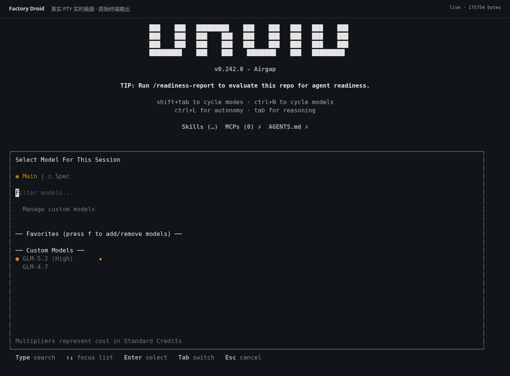
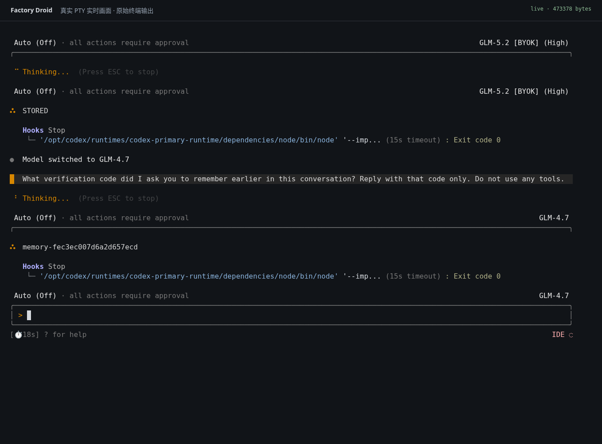
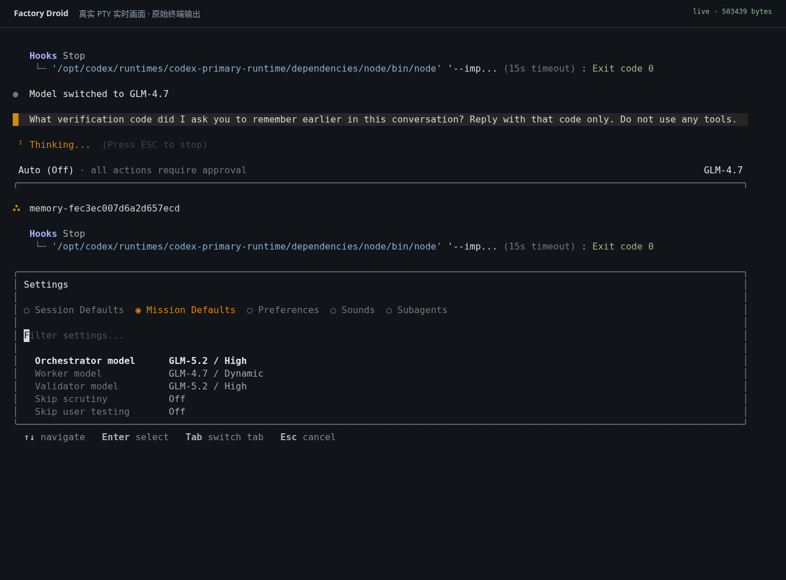

# 选择真实模型，而不是角色标签

普通聊天通过 `/model` 选择实际推理模型。Mission 使用 Factory 原有的 Orchestrator、Worker、Validator 设置，各角色从同一份真实模型列表中选择，可以相同，也可以不同。Bridge 不再给新配置添加 Relay Orchestrator、Relay Worker 等角色模型。

Claude 配置可使用 `sonnet`、`opus`、`haiku` 或实际可用的版本 ID；默认别名显示为 Claude Sonnet、Claude Opus、Claude Haiku，由已安装的官方 Claude Code 解释。清单是显式配置，不代表自动发现账号的全部权益。本次在线验证使用隔离 GLM BYOK，菜单如实显示 GLM-5.2、GLM-4.7，没有使用真实 Claude 订阅。

## 同一对话里的实际模型切换

切换发生在空闲时。Bridge 关闭旧的 SDK query，等待其退出，再通过官方 `resume` 使用原来的 SDK 会话 ID，并刷新实际模型和进程环境。后续只追加新用户输入，不把整段对话作为新提示再次导入。未完成工具、审批、后台任务或缺少持久化 checkpoint 时拒绝切换；可恢复的拒绝不会破坏旧会话。

Factory 切换模型时也可能改变请求中的 thinking 默认值。只有同一已认证 Factory 会话、相同目录和角色、双方有工具目录，并且完整历史或精确保留回合匹配时，才允许这项差异。仅有会话 ID 或相同短提示不足以绕过校验。

跨模型不保证缓存复用。本文验证选择和上下文续接，没有测量 Claude 模型的实际账单、账号策略或跨模型缓存命中率。

## 实测结果

最终[真实验证 r3](../evidence/real-model-switch-validation-2026-10-16-r3.json)的 17 项核心检查通过：官方 Claude Code 的实际响应模型从 `glm-5.2` 变为 `glm-4.7`，Factory、Bridge 和原生 SDK 三层会话 ID 都不变，生产日志记录 `sdk_model_changed` / `strategy: resume`。

第一轮只在 GLM-5.2 的输入中给出随机码；第二轮只询问之前的码，不再次提供它。GLM-4.7 正确回忆，第二轮原生输入也不含该码，第一轮指令在原生历史中只出现一次。这些检查排除了“新建会话并重放历史后答对”的假通过。原生错误、待处理工具与审批均为零。

加上生命周期、源码一致性和真实持久化配置复验，共 29 项检查通过。42 个运行进程正常退出，零强制结束、零残留；端口、临时管理员令牌、hooks 配置与启动锁均清理。运行前后源码指纹一致，且与最终离线测试记录匹配。

## 真实截图

以下图片来自官方 Droid 的真实 PTY 输出，经 xterm 和 Chromium 截图；没有绘制模拟界面、修改图片或使用图像生成。

[截图清单](../evidence/droid-model-switch-2026-10-16/capture-manifest.json)包含图片和对应终端字节的哈希、时间、操作来源和截图进程清理记录。

模型菜单中的两个选项是实际 BYOK 模型：

切换后的对话结果：

Mission 仍使用原有角色设置，图中 Worker 选择 GLM-4.7，Orchestrator 和 Validator 选择 GLM-5.2：

Mission 图片证明真实设置项和保存结果；本轮没有执行完整的多模型 Mission。此前的完整 Mission 证据属于当时的单一上游模型配置。

## 保留的失败与修复

第一次运行确实换了实际模型并答对随机码，但原生 SDK 会话被新建，历史也被重新导入。原因是 GLM-5.2 请求带 `thinking.enabled`，GLM-4.7 请求不带该字段，旧关联逻辑把这种差异当成了新会话。[失败分析](../evidence/real-model-switch-failure-analysis-2026-10-16.json)与[原始失败记录](../evidence/real-model-switch-validation-2026-10-16.json)保留，不能用其截图中的正确回答冒充原生会话复用。

第二次运行尚未切换模型，GLM-5.2 在 `STORED` 后补充了“只在当前对话记忆、不写入持久化存储”的说明。旧观察器要求逐字相等，因而提前结束。[该轮记录](../evidence/real-model-switch-validation-2026-10-16-r2.json)与[观察器诊断](../evidence/real-model-switch-r2-observer-diagnosis-2026-10-16.json)保留；后续只去掉首轮无关的格式限制，真实模型、会话 ID、随机码和禁止历史重导入的检查不变。

另一个实测问题是 Droid 会给模型配置补充 `id`、`index`、`noImageSupport:false`，旧管理签名因此不能识别自己添加的模型，重新配置会出现重复。签名现已忽略这些派生字段，仍保护用户的非默认修改。[真实持久化配置的离线复验](../evidence/model-selection-persistence-validation-2026-10-16.json)确认没有重复模型，且用户保存的不同 Mission 选择保留。

最终源码的[449 项离线测试、类型检查和构建](../evidence/model-selection-offline-validation-2026-10-16.json)均通过。Subscription 只做注入 SDK 的离线参数验证，没有使用账号登录。
