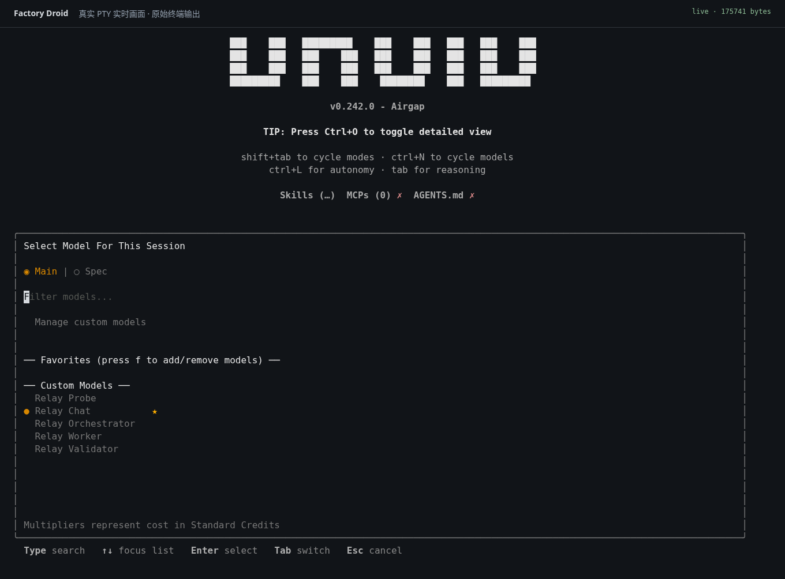
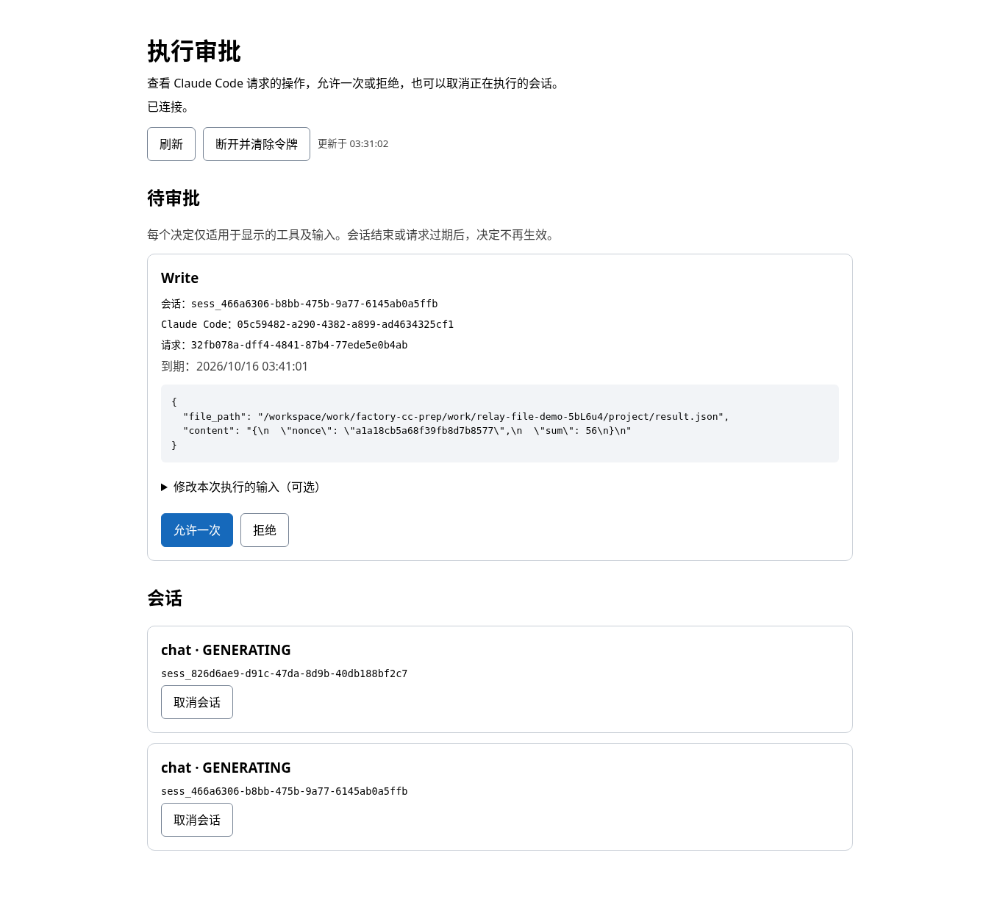
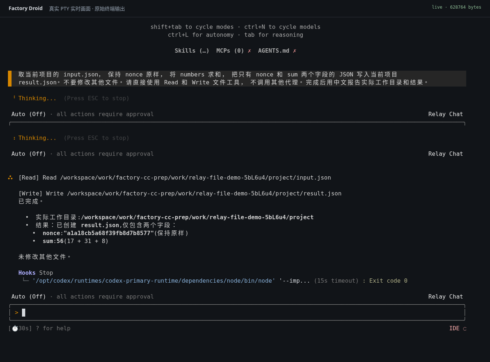
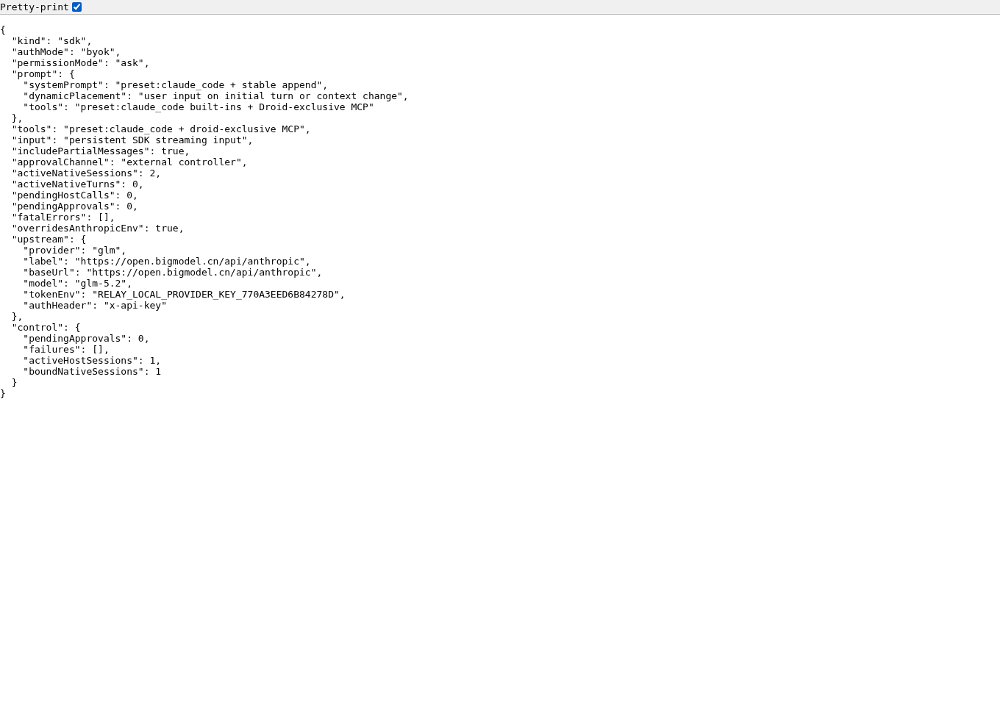

# Droid → Claude Code → GLM BYOK：真实界面与文件操作

> 本页保留旧版角色菜单时期的文件操作证据。当前产品已改为真实模型列表；本页的 Relay 菜单截图不是当前菜单，也不证明新版本的模型切换。

2026-10-16，在现有 `npm run local` 入口上运行官方 Droid 和 Claude Code。运行时上游是 `https://open.bigmodel.cn/api/anthropic`、`glm-5.2`，权限保持 `ask`。本次没有使用 Claude 订阅。

## 该次运行的目录与模型行为

- 目录仍由 launcher 的项目参数固定。Droid 的 hook 报告实际目录并用于会话校验；当前没有实现安装一次后自动跟随所有 Droid 项目的全局入口。
- 菜单里的五个 Relay 选项是角色通道，共用这次启动指定的一个 BYOK 模型。它们不是五个真实模型，不能通过该菜单直接切换到 Sonnet、Opus 或 Haiku。
- 可以在启动时配置其它兼容服务的 endpoint 和 model ID；是否可用需要相应服务权限与实际验证。本页只为 GLM-5.2 的这次运行提供证据。

## 1. Droid 的实际模型菜单

同一个真实交互会话打开 `/model`，当前选择 Relay Chat。

## 2. Claude Code 原生 Write 的实际审批

任务要求读取项目中的 `input.json`，保留随机 `nonce`，将 `numbers` 求和后写入 `result.json`。提示没有提供随机值，模型需要读取文件才能得到它。

下图来自产品本身的 `/control` 页面。卡片显示原生 Claude Code 会话、Write 的目标路径和实际内容；截图后通过浏览器点击“允许一次”，服务返回 HTTP 200。

## 3. 完成后的真实 Droid 界面

原生 Read 和 Write 均有成功回执，磁盘结果也独立核对过：随机值原样保留，`17 + 31 + 8 = 56`。工作目录、输入路径和输出路径属于同一个测试项目。

## 4. 实际运行接口

这是 Chromium 自带 JSON 查看器展示的 `/internal/runtime` 响应，显示 `sdk`、`byok`、`ask` 和 `glm-5.2`。其中 `tokenEnv` 只是变量名，没有密钥值。

## 证据方法与范围

Droid 截图把该次真实 PTY 的原始 ANSI 输出实时送入 xterm.js，再使用 Chromium 截图；页眉标明了这一点。审批截图来自真实产品页面。图片没有编辑、拼接或生成模拟界面。[截图清单](../evidence/droid-local-files-2026-10-16/capture-manifest.json)记录时间、图片哈希、对应终端字节哈希和实际批准操作。

[同次运行的独立复核](../evidence/local-file-operation-recheck-2026-10-16.json)包含 27 项通过的检查：原生工具结果、磁盘内容、目录归属、浏览器批准、辅助请求的越权读取被拒绝，以及正常退出和清理。23 个运行进程与 12 个截图进程均已结束。最初自动观察器的[失败记录](../evidence/local-file-operation-validation-2026-10-16.json)仍保留；它没有匹配到终端实际提交的提示，退出后仍轮询服务而报错。复核使用同一次运行的原始记录和磁盘快照，没有重跑模型或把模型自述当成执行成功。

本页证明这次桥接和文件读写链路真实执行；全局自动目录、菜单内切换不同真实模型、完整 Mission 和独立 Agent Readiness 都不属于这次截图验收的结论。
